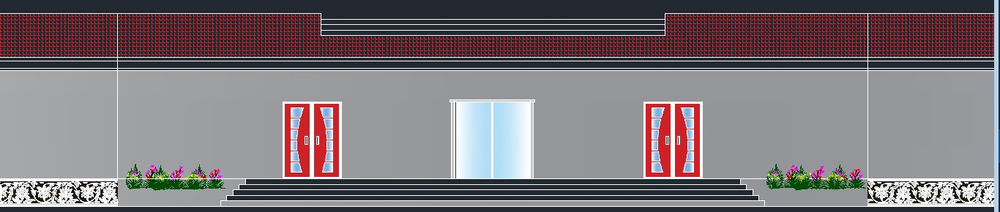
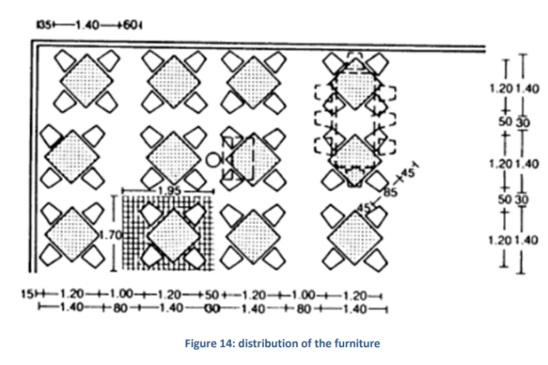
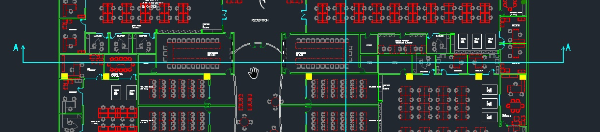
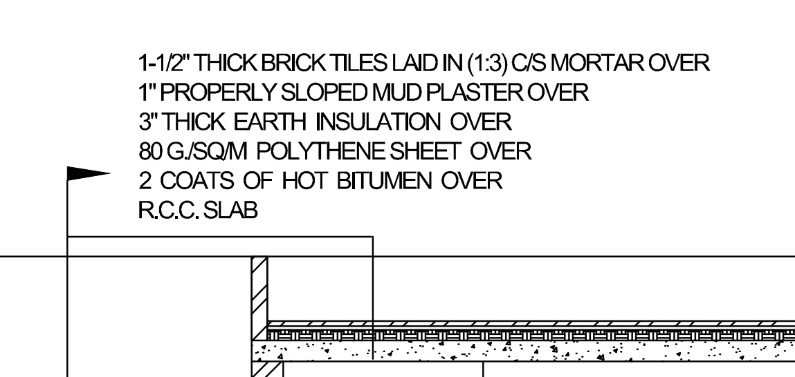
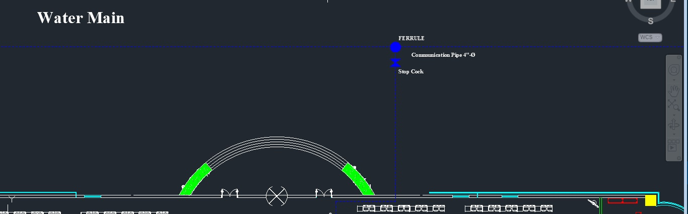
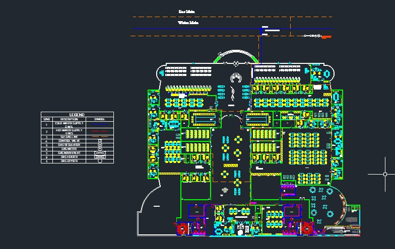
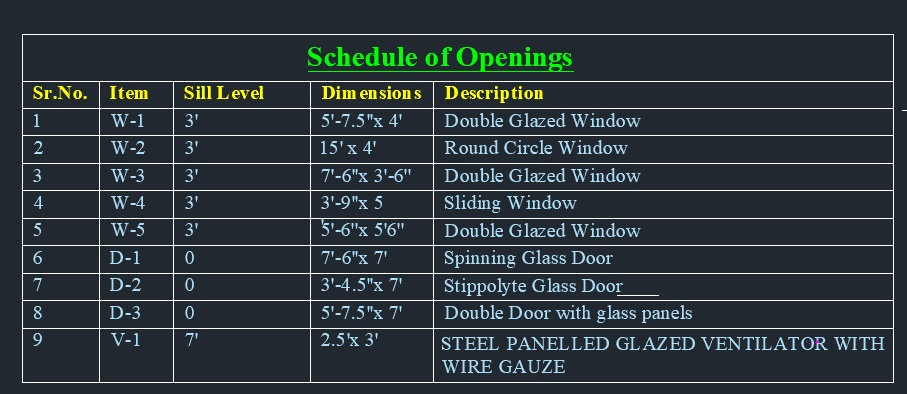

# Comprehensive Architectural & MEP CAD Design: Commercial Office Building


[](https://www.autodesk.com/products/autocad)
[](#)
[](#)
[](#)
[](LICENSE)

---

## 📌 Executive Summary

This repository contains the complete **Computer-Aided Design (CAD)** portfolio for a **14-Kanal (280 Marla) modern sustainable commercial office building**, developed during the 5th Semester Civil Engineering curriculum.

The project encompasses end-to-end design documentation—from architectural space planning, site circulation, and structural multi-view projections to detailed **Mechanical, Electrical, and Plumbing (MEP)** engineering (water distribution, natural gas routing, and schedule of openings). Both native Autodesk AutoCAD (`.dwg`) format and universal vector (`.pdf`) format are provided for direct inspection in any browser or CAD workstation.

---

## 🏛️ Project Details & Technical Specifications

| Parameter | Specification | Notes / Standards |
| :--- | :--- | :--- |
| **Project Type** | Commercial Office Facility | Ground Floor Multi-Functional Complex |
| **Site Area** | 14 Kanal (280 Marla) | Comprehensive commercial compound |
| **Primary Drafting Software** | Autodesk AutoCAD | Vector layers, standard linetypes & hatches |
| **Architectural Standards** | Neufert Architects' Data (2012) | Circulation, ADA compliance, exit widths |
| **Building Services (MEP)** | Water Supply & Natural Gas | Closed-loop distribution & safety valves |
| **Environmental Strategy** | Green & Energy-Efficient Design | Double glazed insulation, cool roof, solar planning |
| **Design Team** | **Muhammad Umer Basit (Lead)**<br>Muhammad Abdullah<br>Muhammad Talha Nadeem | Civil Engineering, 5th Semester |

---

## 📐 Architectural Design & Space Planning



### 1. Entrance & Inclusive Access
- Triple-door grand entrance foyer with automated rolling glass doors.
- Universal accessibility: ADA-compliant wheelchair access ramps alongside primary stairs.
- Landscaped exterior buffers with biophilic elements to optimize street frontage aesthetics.

### 2. Reception & Client Welcoming Zone
- Centrally positioned front reception desk with unobstructed visibility across the entrance hall.
- Expansive waiting lounge equipped with media displays and counter modules for visitor management.

### 3. Workspaces & Ergonomic Innovation
- **Executive Suites & Departmental Offices**: Private offices positioned along exterior walls to leverage natural daylighting.
- **Modular Workstations**: Open-plan layout configured for flexible team density and lower reconfiguration costs.
- **Treadmill Desks**: Dedicated wellness-oriented active workstations incorporated to support ergonomic workplace health.
- **Conference & Boardrooms**: High-capacity meeting facilities dimensioned according to occupant load calculations.



### 4. Amenities & Employee Wellbeing
- **Cafeteria & Commercial Kitchen**: Ground-floor cafeteria sized at 60 cm width $\times$ 40 cm depth per diner with distinct food preparation, serving, and dry-storage areas.
- **Quiet Rooms & Prayer Facilities**: Dedicated ablution and prayer spaces for men and women.
- **Recreation & Game Lounge**: Stress-reduction break area for team decompression.
- **Water Closets (WCs)**: Segregated gender-specific facilities with cross-ventilation shafts.

### 5. Vehicular Parking & Circulation
- Standard parking bays dimensioned to $2.3\text{ m} \times 5.0\text{ m}$ for smooth traffic turning radii.
- Dedicated accessible handicap bays ($2.4\text{ m}$ width $+ 1.2\text{ m}$ rear loading corridor) for wheelchair hoist access.
- Dedicated Parent & Child parking spaces.

---

## 🔍 Structural Sections & Elevations

The building geometry and construction systems are documented through longitudinal and transversal cross-sections and detailed exterior elevations:

| Drawing Sheet | Description | Key Structural Features Shown |
| :--- | :--- | :--- |
| **Front Elevation** | Modern commercial facade | Double-glazed curtain walls, rolling glass entrance, architectural parapet |
| **Section A-A'** | Transversal cross-section | Foundation plinth, slab levels, vertical clearance, ceiling voids |
| **Section B-B'** | Longitudinal cross-section | Structural grid, stair tread/riser geometry, roof parapet |

### Section A-A'


### Section B-B'


---

## 💧 MEP Engineering (Plumbing & Gas Distribution)

A commercial facility requires coordinated building services to prevent clash points between structural elements and utility piping.

### 1. Water Supply Distribution Plan

- Sized distribution mains connecting water tanks to executive restrooms, employee WCs, cafeteria kitchen, and outdoor irrigation.
- Clean layout showing isolation valves, pipe diameters, fixture connections, and wastewater drainage routes.

### 2. Natural Gas Distribution Plan

- Dedicated low-pressure natural gas lines routed directly to commercial cafeteria stoves and thermal heating modules.
- Safety isolation points placed outside occupancy zones in full compliance with municipal building codes.

### 3. Schedule of Openings & Symbol Legend

- Comprehensive schedule indexing every door and window by tag ($D_1, D_2, W_1, W_2$).
- Specifies opening dimensions, sill heights, lintel heights, and glazing specifications (thermal double-glazed acoustic panes).

---

## 🌿 Sustainable & Green Building Strategies

The design integrates sustainable architecture principles to reduce operational lifecycle costs:
1. **Double-Glazed Fenestration**: High-performance insulating glass units (IGU) reducing solar heat gain during summer and retaining heat during winter.
2. **Cool Roof Thermal Barrier**: High-albedo reflective roof coating minimizing the urban heat island effect and cutting HVAC chiller cooling loads.
3. **Rooftop Solar Photovoltaic Layout**: Structural provision on roof slabs for solar panel mounting racks.
4. **Biophilic Air Purification**: Interior placement of spider plants (*Chlorophytum comosum*) and natural air-filtering flora to enhance Indoor Air Quality (IAQ).

---

## 📚 Coursework Laboratory Practicals (Labs 1 – 7)

In addition to the capstone commercial office project, this repository preserves the laboratory drafting assignments completed by **Muhammad Umer Basit** (Student ID: `259084`, Section C):

| Practical | Module Title | Deliverables | Formats |
| :---: | :--- | :--- | :---: |
| **Lab 01** | Building Drawing Submission & Standards | Site plan, boundary wall, title block standards | `.dwg`, `.pdf` |
| **Lab 02** | Structural Drafting: Isolated Footings | Foundation footing reinforcement, concrete cover | Spec `.pdf` |
| **Lab 03** | Structural Drafting: Reinforced Concrete Beam | Longitudinal section, shear stirrup spacing, anchorage | `.dwg`, `.pdf` |
| **Lab 04** | Architectural Drafting: Staircases | Tread & riser calculations, landing details, handrails | Spec `.pdf` |
| **Lab 05** | Building Services: Plumbing Details | Pipe networks, cleanouts, sanitary fixtures | `.dwg`, `.pdf` |
| **Lab 06** | Multi-View Projections & Section Projections | Isometric to orthographic conversions, cross sections | `.dwg`, `.pdf` |
| **Lab 07** | Architectural Working Drawing | Complete room plan, window schedules, wall thicknesses | `.dwg`, `.pdf` |

---

## 📂 Repository File Structure

```text
AutoCAD-Commercial-Office-Building/
│
├── README.md                                  # Repository overview and documentation
├── LICENSE                                    # MIT License
├── .gitignore                                 # Ignores CAD lockfiles (*.dwl, *.bak, *.tmp)
│
├── docs/                                      # Project documentation & presentation
│   ├── Office-Building-Design-Presentation.pptx
│   └── lab-specifications/                   # Academic lab briefs and design problem statements
│       ├── Lab-1---BUILDING-DRAWING-SUBMISSION.pdf
│       ├── Lab-2-Structural-ISOLATED-FOOTING.pdf
│       ├── Lab-3-Structural-Beam-Day-Scholars.pdf
│       ├── Lab-3-Structural--Hostelites.pdf
│       ├── Lab-4-Stairs.pdf
│       └── Lab-5-Plumbing.pdf
│
├── drawings/
│   ├── architectural/                         # Full project architectural drawings
│   │   ├── Floor-Plan-Master-Schedule-Legend.dwg
│   │   ├── Floor-Plan-Master-Schedule-Legend.pdf
│   │   ├── Front-Elevation.dwg
│   │   ├── Front-Elevation.pdf
│   │   ├── Cross-Sections-A-B.dwg
│   │   └── Cross-Sections-A-B.pdf
│   │
│   ├── mep/                                   # Mechanical, Electrical & Plumbing drawings
│   │   ├── Gas-Supply-Distribution-Plan.dwg
│   │   └── Gas-Supply-Distribution-Plan.pdf
│   │
│   └── coursework-labs/                       # Individual semester lab practicals
│       ├── Lab-01-Foundation-Drafting-Task1.dwg / .pdf
│       ├── Lab-03-Reinforced-Concrete-Beam.dwg
│       ├── Lab-05-Plumbing-Schematic.dwg
│       ├── Lab-06-Section-Projections.dwg / .pdf
│       ├── Lab-06-Multi-Views.dwg / .pdf
│       └── Lab-07-Architectural-Plan-Layout.dwg / .pdf
│
└── media/                                     # High-resolution rendering previews for README
    ├── hero-elevation.png
    ├── elevation-render.jpg
    ├── section-a.jpg
    ├── section-b.jpg
    ├── water-supply.jpg
    ├── gas-supply.jpg
    ├── schedule-openings.jpg
    ├── cafeteria-layout.png
    ├── layout-overview.png
    └── parking-planning.png
```

---

## 🛠️ Software & File Viewing Instructions

- **Viewing `.dwg` files**:
  - Full Editing: **Autodesk AutoCAD 2021 or newer**.
  - Free Viewing: [Autodesk Viewer (Browser-based, no install required)](https://viewer.autodesk.com/) or **Autodesk DWG TrueView**.
- **Viewing `.pdf` sheets**:
  - Open directly on GitHub using the native GitHub PDF viewer, or in any web browser / Adobe Acrobat.

---

## 👤 Author & Academic Attribution

- **Lead Designer / Drafter:** [Muhammad Umer Basit](https://github.com/MuhammadUmerBasit)  
  *Civil Engineering Student & BIM Specialist*
- **Project Collaborators:** Muhammad Abdullah, Muhammad Talha Nadeem  
- **Course:** Computer Aided Design (CAD), Semester 5

---

## 📄 License

This project is licensed under the [MIT License](LICENSE) — you are free to use and adapt these drawings with appropriate credit.
